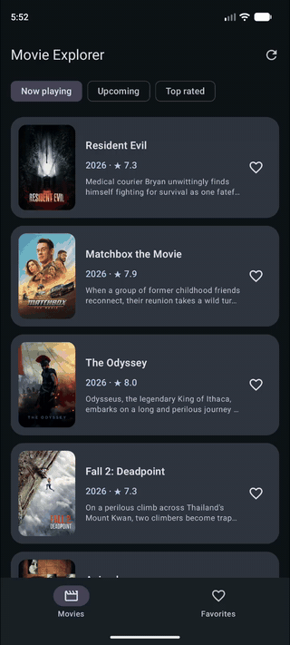

# Movie Explorer

Android movie browser built with Jetpack Compose, plus a Spring Boot API and PostgreSQL.
Browse Now Playing, Upcoming and Top Rated, open details, and save favorites offline.

## Demo

<table>
  <tr>
    <td width="280">
      <a href="docs/movie-explorer-demo.mp4">
        
      </a>
    </td>
    <td>
      <strong>A 42-second walkthrough</strong><br><br>
      Now Playing, Upcoming and Top Rated<br>
      Movie details and animated navigation<br>
      Favorite sync failure, retry and successful recovery<br>
      Offline browsing with cached posters<br><br>
      <a href="docs/movie-explorer-demo.mp4">Full demo · MP4 · 720 × 1600</a>
    </td>
  </tr>
</table>

## Run the system

**Required:** Android Studio, Android SDK 37, JDK 21, Docker Desktop and a TMDB credential.

1. Copy the configuration template:
   ```sh
   cp .env.example .env
   ```
2. Set `TMDB_READ_ACCESS_TOKEN` or `TMDB_API_KEY` in `.env`. The read token is used when both are set.
3. Start the API and database:
   ```sh
   docker compose up -d --build
   ```
4. Wait for [health](http://localhost:8080/actuator/health) to report `UP`.
5. Open `mobile/` in Android Studio, select JDK 21, sync, and run `app` on an emulator.
   On Android 17, allow local-network access when prompted.

| Tool | Address / file |
| --- | --- |
| Swagger UI | [localhost:8080/swagger-ui/index.html](http://localhost:8080/swagger-ui/index.html) |
| OpenAPI | [localhost:8080/v3/api-docs](http://localhost:8080/v3/api-docs) |
| Postman collection | [backend/postman/MovieExplorer.postman_collection.json](backend/postman/MovieExplorer.postman_collection.json) |

The emulator uses `http://10.0.2.2:8080/`. For a USB device, run `adb reverse tcp:8080 tcp:8080`,
set `BACKEND_URL=http://127.0.0.1:8080/` in `.env`, and rebuild the app.
`BACKEND_URL` must end with `/`; release builds require HTTPS.

## Configuration and behavior

- Android reads `.env` or environment variables at **build time**; rebuild after changing them.
  Spring reads TMDB credentials at **runtime**; recreate the backend after changing them.
  `.env` is excluded from Git.
- Movie requests use the backend, then direct TMDB, then saved Room data.
- Online startup prepares three pages per tab and their posters. Further requested pages are saved too.
  Metadata stays in Room; posters use a 100 MiB disk cache with 24-hour online freshness.
- Favorites update locally first and sync on launch, reconnection, a change, or manual retry.
  Failures show a short snackbar; retry shows progress and its result.
- `docker compose down` stops the services and preserves the PostgreSQL volume.

See the [architecture diagram and data flow](docs/architecture.md),
[mobile decisions and limitations](mobile/README.md), and [backend API](backend/README.md).

## Run automated tests

From the repository root:

```sh
mobile/gradlew -p mobile :app:testDebugUnitTest
# With an emulator or connected device:
mobile/gradlew -p mobile :app:connectedUiTestAndroidTest
backend/mvnw -f backend/pom.xml verify
```

Tests do not need TMDB credentials. Backend integration tests require Docker Desktop and use
a disposable PostgreSQL container, separate from the development database.

## Bonuses and next steps

| Optional item | Status |
| --- | --- |
| Critical mobile unit tests | Implemented: view models, repositories and mappers |
| Compose UI tests | Implemented: navigation actions, pagination, states and favorite retry |
| Backend unit/integration tests | Implemented, including HTTP and PostgreSQL persistence |
| Advanced client offline caching | Implemented: multiple pages per tab, details and poster prefetch |
| Architecture diagram | [Components and data flow](docs/architecture.md) |
| Launcher icon | Custom adaptive cinema icon, including Android themed icons |
| KMP module | Not implemented |
| Macrobenchmark | Not implemented; measure cold startup and scrolling in a dedicated module |
| Trailer playback | Not implemented |
| API versioning | Not implemented |
| Backend TMDB response caching | Not implemented |
| Idempotent favorite creation / HTTP 409 | Not implemented; duplicate favorites return 400 |

Further improvements beyond the assignment:

- Replace manual `AppGraph` wiring with Hilt/Koin when the dependency graph grows.
- Split domain/data/features into Gradle modules as the application grows.
- Add accessibility checks and broader device, screen-size and UI test coverage.
- Add account authentication and multi-device favorite conflict resolution; the current
  installation-local set takes precedence during synchronization.
- Move reliable background synchronization to WorkManager and expose cache storage controls.
- Review credential distribution and enforce HTTPS for a production deployment.

The submission prioritizes the required flows and tested behavior. KMP, trailers and performance
benchmarks are intentionally left for a further iteration.
