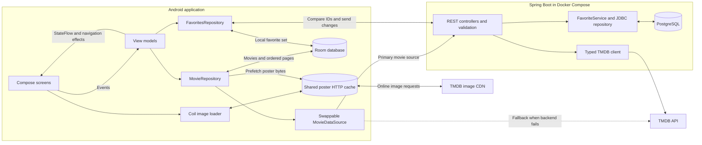

# Architecture and data flow

The Android app uses Compose, MVI and Clean Architecture. Domain models and repository
contracts do not depend on Android or networking. `AppGraph` constructs the implementations.
The Spring Boot service shapes TMDB data and persists installation-specific favorites.

## Movie browsing

1. A screen sends an event to its view model. The view model owns loading and pagination.
2. The movie repository requests the backend; the remote source falls back to TMDB on failure.
   With no connection, or when both remote sources fail, saved Room data remains available.
3. Successful pages and details are saved in Room. Refreshing a page preserves other pages.
   Online startup/reconnection prepares three pages per tab and prefetches their posters.
4. The view model publishes state; Compose displays loading, content, empty or error UI.
   A status banner explains offline access or direct TMDB fallback.

## Favorites and images

Favorites change in Room immediately. The UI observes the local set. Synchronization compares
local and server IDs, then adds/removes the difference through the backend. A mutex prevents
overlapping reconciliations. The server stores movie snapshots in PostgreSQL, so reading its
favorites does not require TMDB. An installation UUID identifies the set; there is no account
login or multi-device conflict resolution. Failed synchronization shows a short snackbar;
manual retry exposes progress and its result.

Room retains metadata without a time limit. Coil and poster prefetching share an OkHttp disk
cache: images are fresh for 24 hours online and older cached bytes remain usable offline.
The cache is bounded to 100 MiB, so eviction is possible. Preferences store the installation
identifier, not movie data or poster bytes.
